<div align="center">

# BranchSkipper

**Aprenda Git jogando.** Um RPG 2D de exploração em pixel art onde cada comando vira algo que você vê e mexe no mundo:
uma ponte que se monta, um mural que se limpa, duas realidades que se juntam.


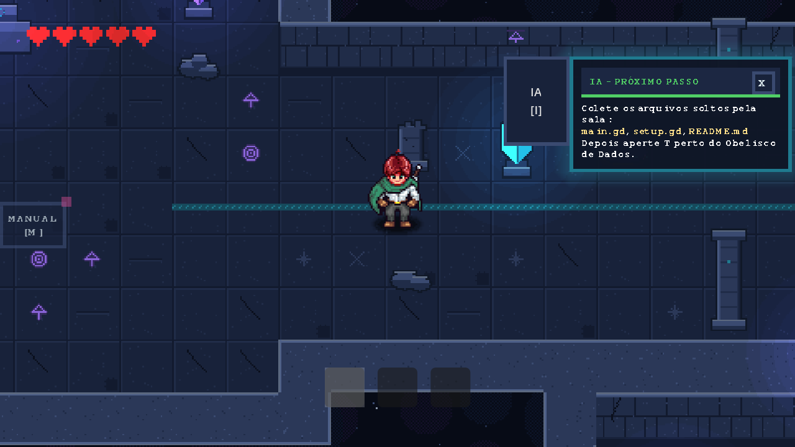

</div>

---

## Sobre o jogo

Você é o **Walker**, o único capaz de atravessar as realidades que se partiram na *Merge Catastrophe*. Para restaurá-las você
usa o mesmo instrumento que os Codex usaram para quebrá-las: **o Git**.

O jogo **não explica Git com texto parado**. O mundo é o repositório:

- uma **ponte** só fica sólida quando o conserto é trazido para a `main` com um `merge`;
- as runas de um **mural** mostram o que mudou (`diff`) e o que se perde se você descartar (`restore`);
- um **conflito de merge** é uma parede de glitch que só cai quando você decide, olhando os dois lados;
- o que você apaga com `reset --hard` **vira poeira** (e o `reflog` lembra);
- as **branches** são realidades em que você entra de verdade.

Tudo usa **comandos reais** num terminal dentro do jogo, com respostas no estilo do Git. Uma IA guia cada passo com metáforas
(a pasta é uma *sala*, a staging area é uma *caixa*, o commit é uma *foto*) e o Manual do Sistema (`M`) guarda a cola dos comandos já apresentados.

## O que cada fase ensina

| # | Fase | Comandos | Em uma frase |
|---|---|---|---|
| 1 | **Sala de Triagem** | `init` · `status` · `add` · `commit` | Registrar o primeiro estado do mundo. |
| 2 | **A Ponte Quebrada** | `log` · `branch` · `switch` · `merge` | Consertar numa cópia segura e trazer de volta. |
| 3 | **O Mural Corrompido** | `diff` · `restore` · `restore --staged` | Ver o que mudou e desfazer só o ruído, sem perder o que está certo. |
| 4 | **Ecos de Possibilidades** | tudo até aqui, num problema maior | Duas realidades paralelas que convergem sem apagar nenhuma. |
| 5 | **Linhas Cruzadas** | merge com **conflito** · `merge --abort` | Conflito não é erro: é o Git pedindo que você decida. |
| 6 | **Ponto de Retorno** | `revert` · `stash` · `reset --soft/--hard` | As três formas de voltar atrás e o custo de cada uma. |

<table>
<tr>
<td width="50%">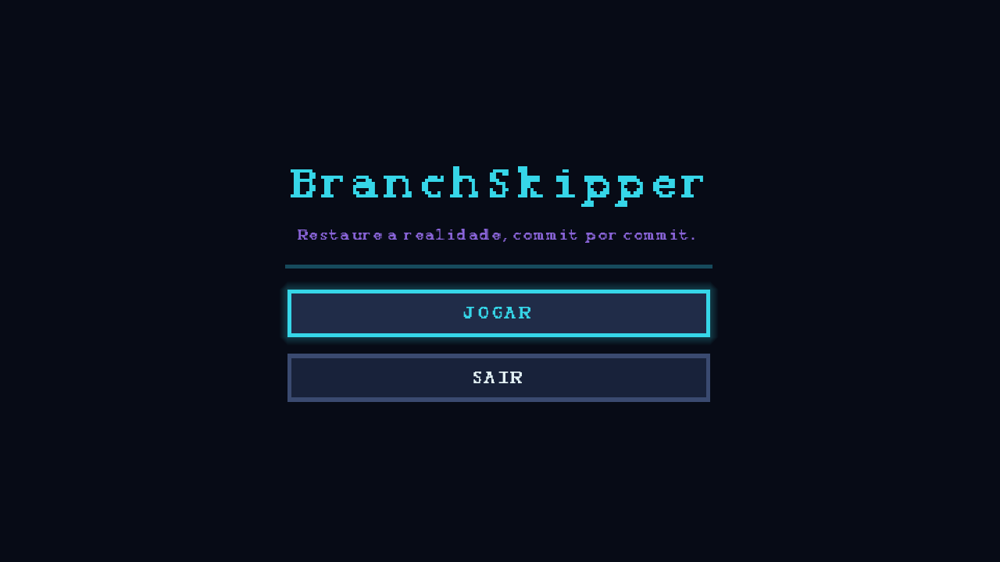<br><sub><b>Menu inicial</b> · JOGAR abre o prólogo</sub></td>
<td width="50%">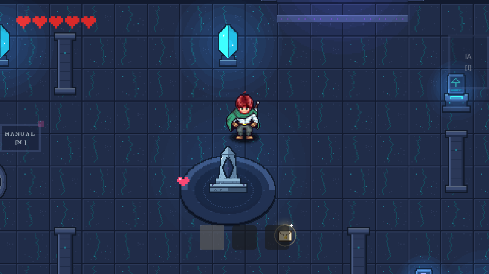<br><sub><b>Fase 1</b> · o santuário e o Obelisco de Dados, o seu terminal</sub></td>
</tr>
<tr>
<td width="50%">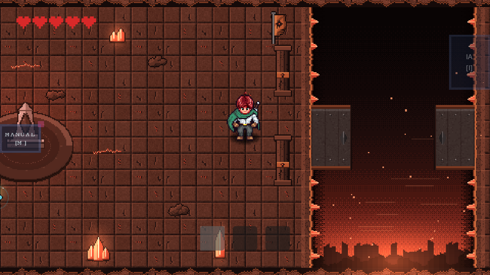<br><sub><b>Fase 2</b> · a ponte está <i>desligada</i>, não caída</sub></td>
<td width="50%">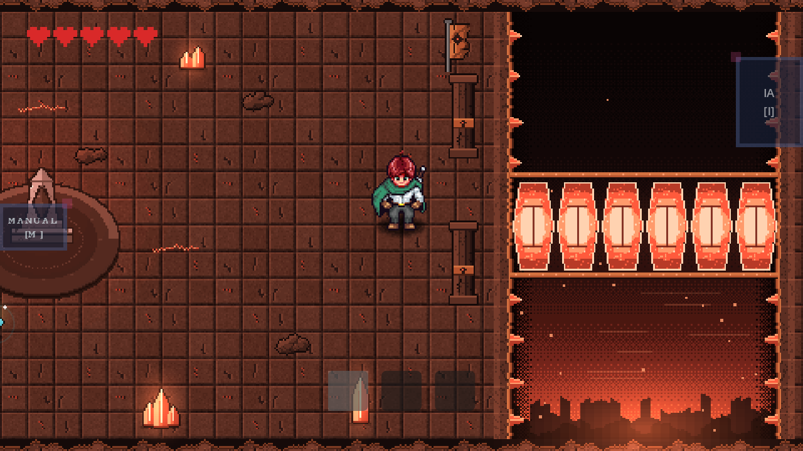<br><sub>o <code>merge</code> acende as placas, uma a uma</sub></td>
</tr>
<tr>
<td>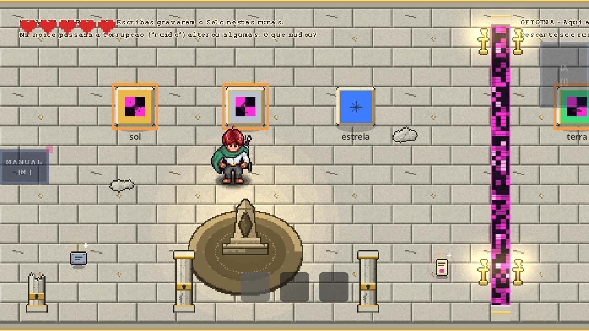<br><sub><b>Fase 3</b> · o ruído magenta é o que sobra do que ninguém registrou</sub></td>
<td>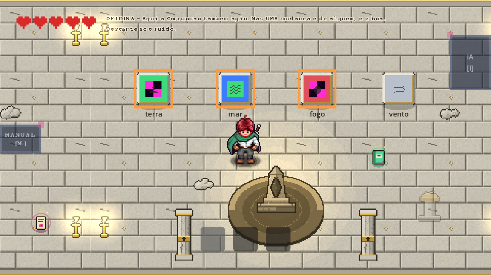<br><sub>a <i>Oficina</i>, o <i>Palco</i> e o <i>Arquivo</i> são a pasta, a staging e o commit</sub></td>
</tr>
<tr>
<td>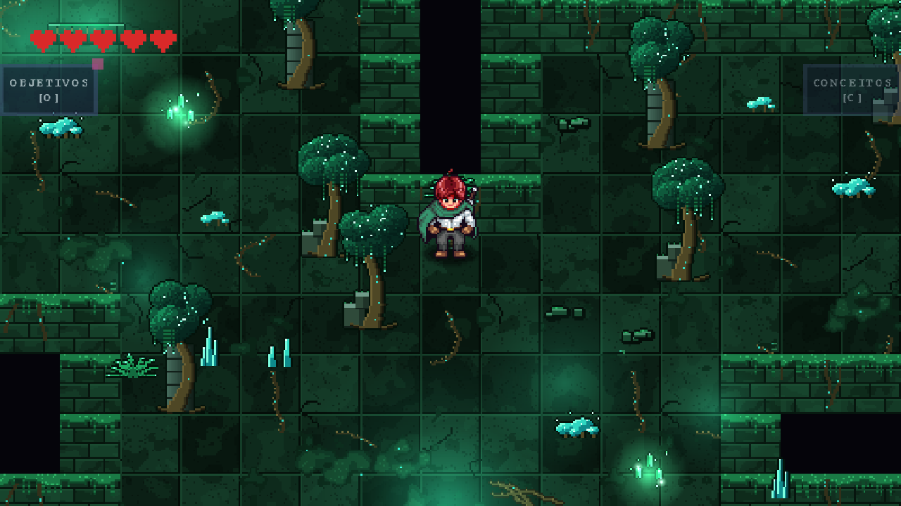<br><sub><b>Fase 4</b> · a branch <code>vida-alternativa</code>: outra realidade, de verdade</sub></td>
<td>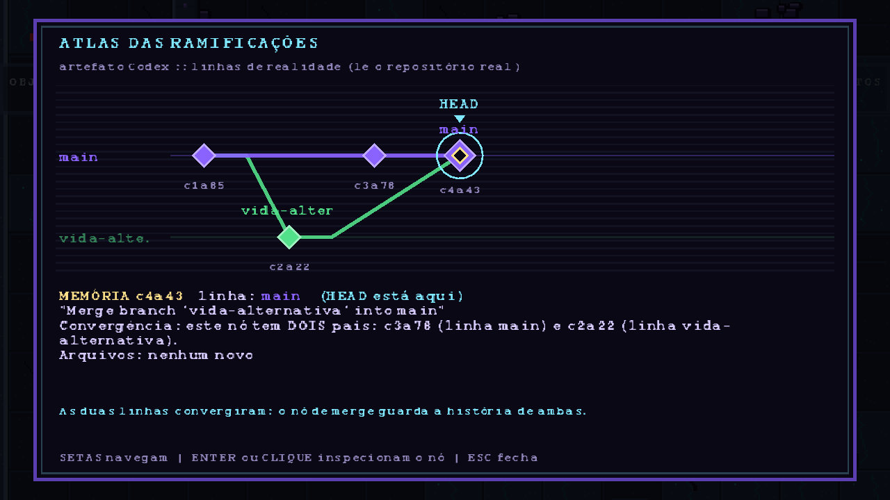<br><sub>o <b>Atlas</b> desenha o repositório real, com o nó de merge de dois fios</sub></td>
</tr>
<tr>
<td>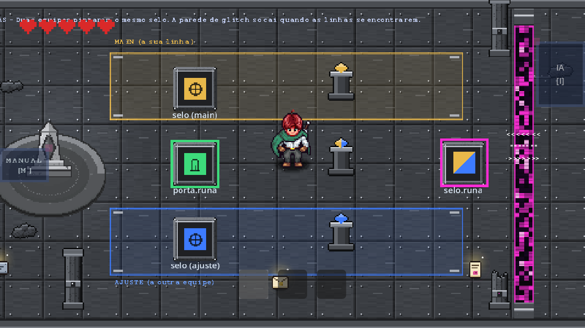<br><sub><b>Fase 5</b> · dois selos, duas equipes, um conflito</sub></td>
<td>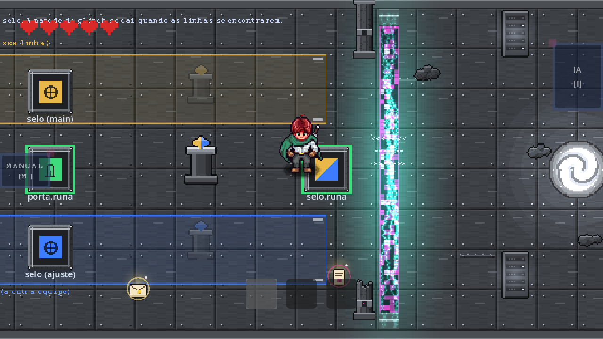<br><sub>juntar as duas versões racha a parede com uma luz nova</sub></td>
</tr>
<tr>
<td>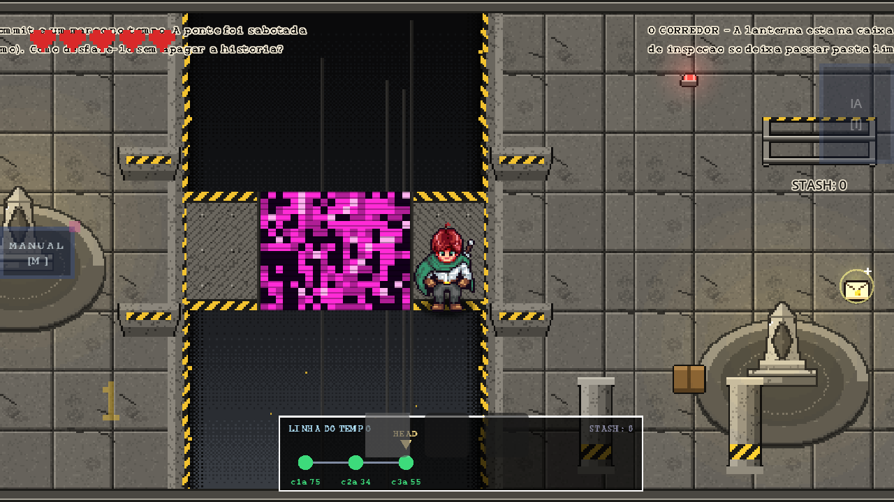<br><sub><b>Fase 6</b> · a linha do tempo de commits, ao vivo, na base da tela</sub></td>
<td>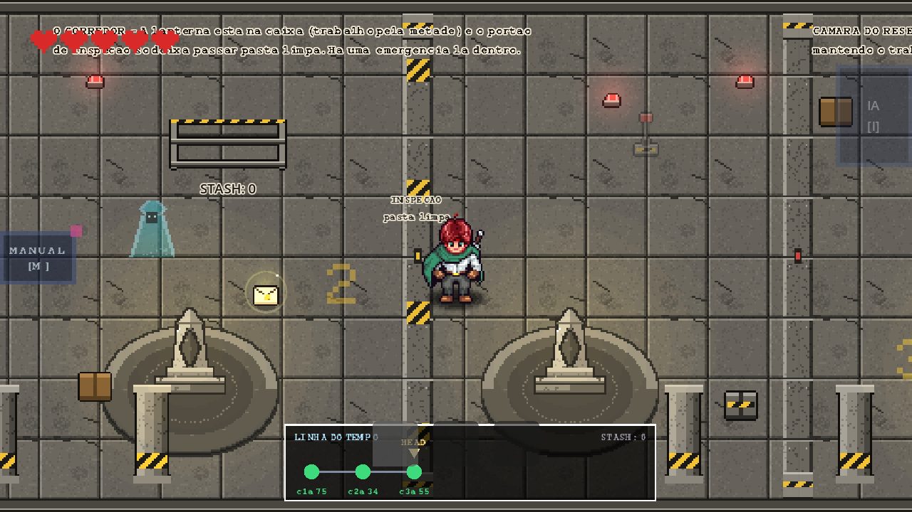<br><sub>o <code>stash</code> guarda o trabalho; um vulto evita você no corredor</sub></td>
</tr>
</table>

## Como funciona

**O terminal.** Em cada fase há um Obelisco (`T` perto dele). Os comandos são liberados um de cada vez, conforme a IA os apresenta;
um comando fora de hora é recusado com uma dica, e erros típicos têm explicação própria.

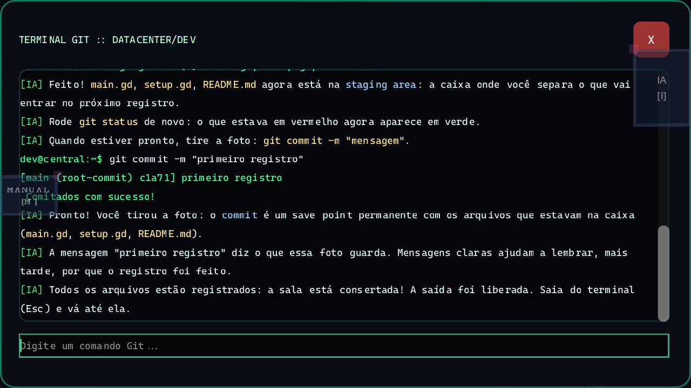

**As vozes.** A **IA** ensina e comenta. O **Eidolon**, um arquivista fragmentado, aparece a partir da Fase 4 com uma visão oposta
(*"uma linha deve prevalecer"*), e as duas vozes reagem ao que você faz, inclusive às suas **escolhas**.

**Notas e Diário.** Placas, cartas e atas espalhadas pelo mundo (opcionais) contam a história sem tirar o foco do Git. O que você lê fica
no **Diário**, no menu de pausa. A marca de "lida" vale por tentativa da fase: se você morrer, as notas voltam a brilhar, mas continuam no Diário.

<table>
<tr>
<td width="50%">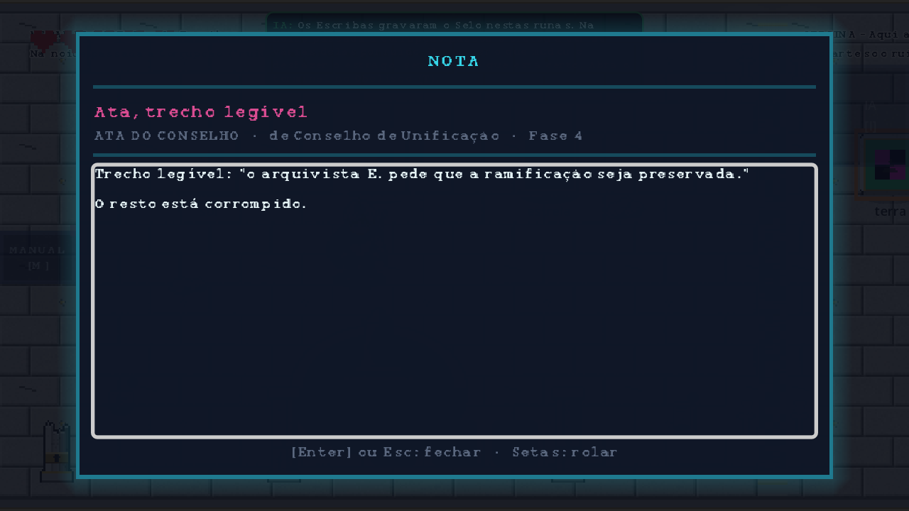</td>
<td width="50%">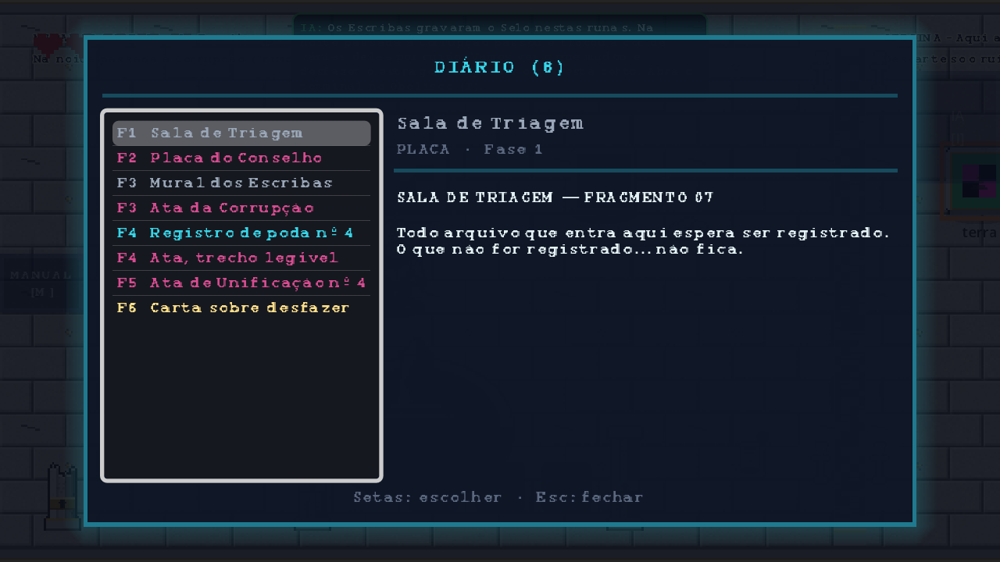</td>
</tr>
</table>

**Errar é seguro.** Há armadilhas de propósito (descartar a mudança boa, um `reset --hard` no arquivo errado) e redes de segurança para
ninguém ficar preso. Morrer ou usar **REINICIAR FASE** recomeça a fase **do zero**: o Git, o inventário e o progresso voltam ao que eram ao entrar nela.

**HUD que não atrapalha.** Os painéis (quadro da IA, Manual, Objetivos e Conceitos da Fase 4) são recolhíveis; recolhidos, as abas ficam translúcidas.

<table>
<tr>
<td width="50%">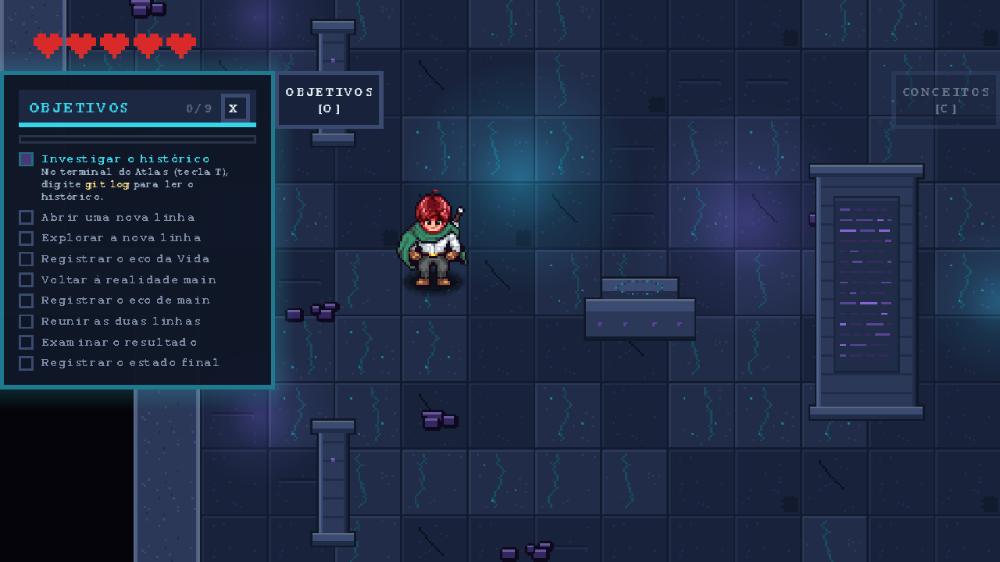</td>
<td width="50%">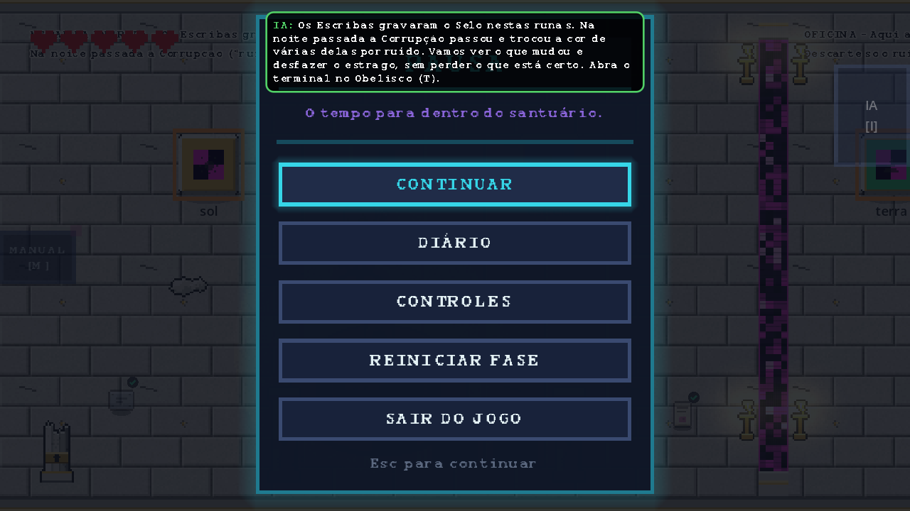</td>
</tr>
</table>

## A história (sem spoilers)

Antes da fragmentação existia uma só realidade. Os **Codex** quiseram eliminar as diferenças e **juntaram à força** linhas
incompatíveis; o universo se quebrou em fragmentos. Os **Walkers** surgiram para restaurá-los usando o Git.
Pelo caminho você encontra uma assinatura que se repete (**E.**), uma ponte que foi *desligada*, uma lei escondida sob o ruído,
um commit que ninguém fez e uma pergunta que fica sem resposta. A história completa está em [`docs/HISTORIA.md`](docs/HISTORIA.md).

## Controles

| Tecla | Ação |
|---|---|
| `W A S D` / setas | Mover |
| `Espaço` | Atacar |
| `Enter` | Interagir: ler notas, usar portões e altares |
| `1` `2` `3` | Selecionar item do inventário |
| `T` | Abrir o terminal (perto de um Obelisco) |
| `M` | Manual do Sistema |
| `I` | Quadro da IA (recolher/abrir) |
| `O` / `C` | Objetivos / Conceitos (Fase 4) |
| `Esc` | Pausa: continuar, **Diário**, **Controles**, **Reiniciar fase**, sair |

## Como rodar

1. Instale a [Godot 4.7](https://godotengine.org/download).
2. Clone o repositório e abra a pasta pelo Godot (`project.godot`).
3. Aperte **F5**: o jogo abre no menu inicial.

Para abrir uma fase direto, abra a cena dela (`fases/fase_N/fase_N.tscn`) e aperte **F6**.

## Testes

Cada fase tem teste automatizado em `test/`, que sai com código 1 se algo falhar. Exemplo, em modo headless:

```
godot --headless --path . res://test/fluxo_fases_test.tscn
godot --headless --path . res://test/fase_5_historia_test.tscn
```

A lista completa e o que cada teste cobre está em [`docs/PLANO_DAS_FASES.md`](docs/PLANO_DAS_FASES.md) (seção 10).

## Estrutura do projeto

```
fases/            Fases 1 a 6 (cena, lógica, tutora, arte em PNG)
terminal/         Terminal Git simulado, comandos e o repositório (GameState)
atlas/            O Atlas das Ramificações (grafo do repositório)
Dialogo/          A IA tutora, o prólogo e a caixa de diálogo
GeneralNodes/     Menus, HUD recolhível, Manual, Notas e Diário, vitória/derrota
Player/ Enemies/  Jogador e inimigos
00_Globals/       Autoloads (FaseManager, LevelManager, PlayerManager)
test/             Testes automatizados
tools/            Geradores de arte e dos prints deste README
docs/             Documentação e imagens
```

## Documentação

| Documento | Assunto |
|---|---|
| [`docs/GUIA_DESENVOLVEDOR.md`](docs/GUIA_DESENVOLVEDOR.md) | Inventário, itens, terminal, `GameState`, notas e ferramentas |
| [`docs/PLANO_DAS_FASES.md`](docs/PLANO_DAS_FASES.md) | Roteiro fase a fase, comandos, decisões, testes |
| [`docs/HISTORIA.md`](docs/HISTORIA.md) | A história completa do jogo (**com spoilers**) |
| [`docs/DESIGN_FASES.md`](docs/DESIGN_FASES.md) | Identidade visual de cada fase e a HUD |
| [`docs/FASE_4_ESTRUTURA.md`](docs/FASE_4_ESTRUTURA.md) | A fase elevada em detalhe: realidades, Eidolon, Atlas |
| [`docs/PLANO_FASES_7_8.md`](docs/PLANO_FASES_7_8.md) | Plano de implementação das duas últimas fases |

## Roadmap

- [x] Fases 1 a 6 jogáveis, com história, arte própria, notas e testes
- [ ] **Fase 7: O Arquivo Vazio** (`reflog`, `cherry-pick`) e **Fase 8: O Apagador** (o chefe e a escolha final) — planejadas em [`docs/PLANO_FASES_7_8.md`](docs/PLANO_FASES_7_8.md)
- [ ] Áudio (música e efeitos) para todas as fases

---

<div align="center">
<sub>Projeto de TCC · feito com Godot 4.7 · os prints deste README são gerados por <code>tools/capturar_prints.tscn</code></sub>
</div>
