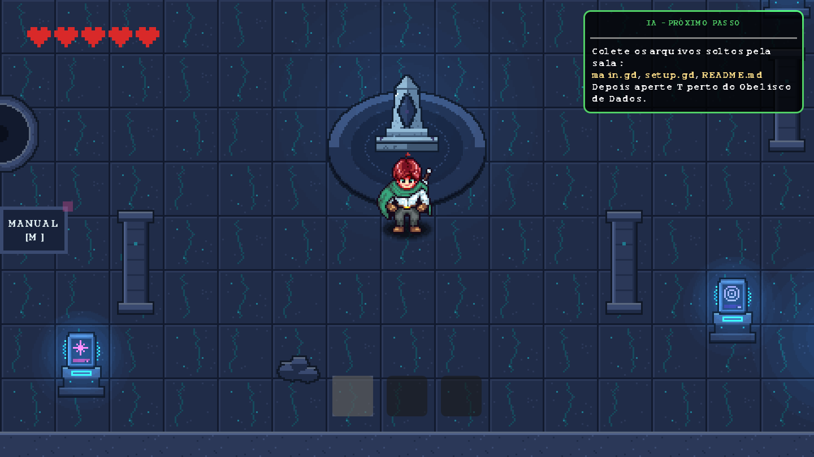
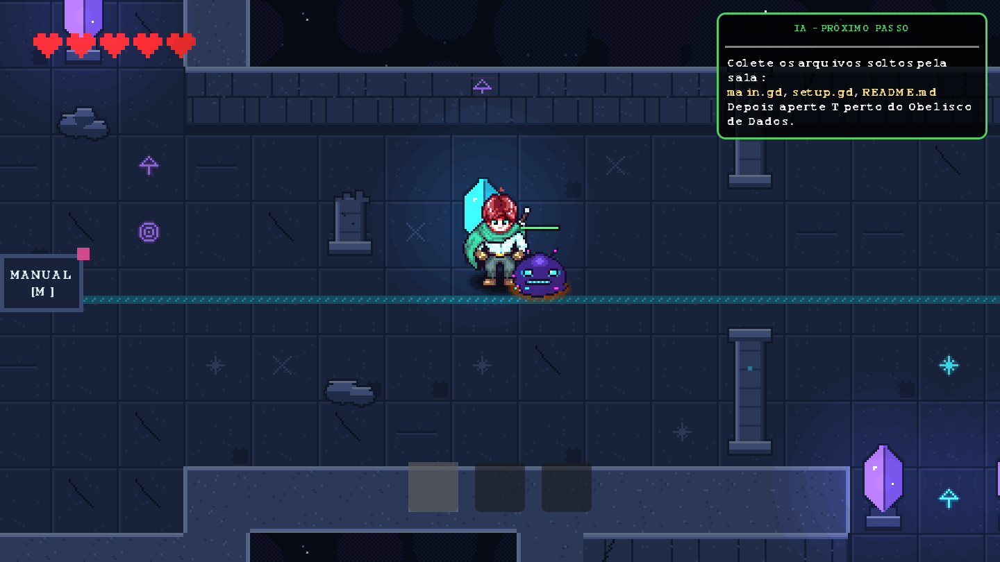
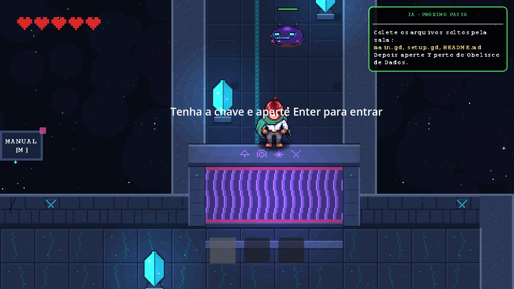
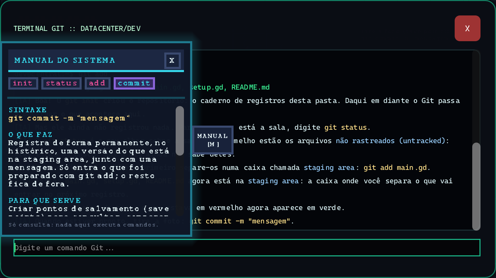
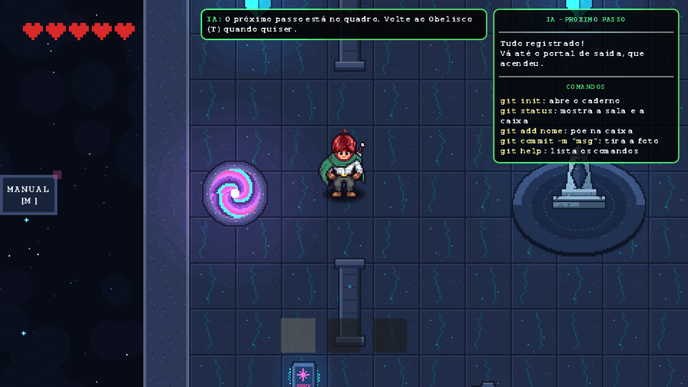

# Branch Walker

Jogo educacional 2D (visão top-down, pixel art) feito na **Godot 4.7** para ensinar **Git** a quem nunca usou.
Você explora um santuário cósmico, recupera arquivos perdidos e usa um terminal Git de verdade (simulado) para registrá-los.

> Projeto de TCC.



## O que o jogo ensina

A **Fase 1** apresenta o fluxo básico do Git, um comando de cada vez:

| Comando | Para que serve |
|---|---|
| `git init` | Cria o repositório |
| `git status` | Mostra o estado dos arquivos |
| `git add` | Prepara arquivos para o próximo commit |
| `git commit` | Registra o que foi preparado |

Uma personagem guia, a **IA**, explica cada passo com uma metáfora (a pasta é uma *sala*, a staging area é uma *caixa* e o commit é uma *foto*) e anota o próximo passo num quadro na tela.
Há também o **Manual do Sistema** (tecla `M`), com um resumo dos comandos já apresentados.

## Como a Fase 1 funciona

1. Explore a galeria e encontre a **chave**.
2. Abra o **Portão de Runas**.
3. Colete os 3 arquivos: `main.gd`, `setup.gd` e `README.md`.
4. Use o **Obelisco de Dados** (terminal) para rodar `init`, `status`, `add` e `commit`.
5. Com tudo registrado, o **portal de saída** acende. Caminhe até ele.

| | |
|---|---|
|  |  |
|  |  |

## Controles

| Tecla | Ação |
|---|---|
| `W A S D` / setas | Mover |
| `Espaço` | Atacar |
| `1` `2` `3` | Selecionar item do inventário |
| `T` | Abrir o terminal (perto do Obelisco) |
| `Enter` | Abrir o portão (com a chave selecionada) |
| `M` | Abrir/fechar o Manual do Sistema |
| `Esc` | Pausar |

## Como rodar

1. Instale a [Godot 4.7](https://godotengine.org/download).
2. Clone o repositório e abra a pasta pelo Godot (`project.godot`).
3. Aperte **F5** para jogar.

## Estrutura

```
fases/        Fases do jogo (fase_1, fase_2)
terminal/     Terminal Git simulado e comandos (GameState)
Dialogo/      IA tutora e diálogos
GeneralNodes/ Menus, HUD, manual, saída e outros componentes
Enemies/      Inimigos (Vírus Corrompido)
Player/       Jogador
Tile Maps/    Tilesets
test/         Testes
docs/         Documentação e imagens
```
